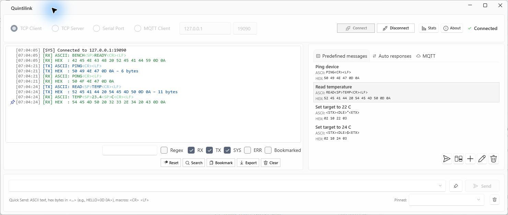
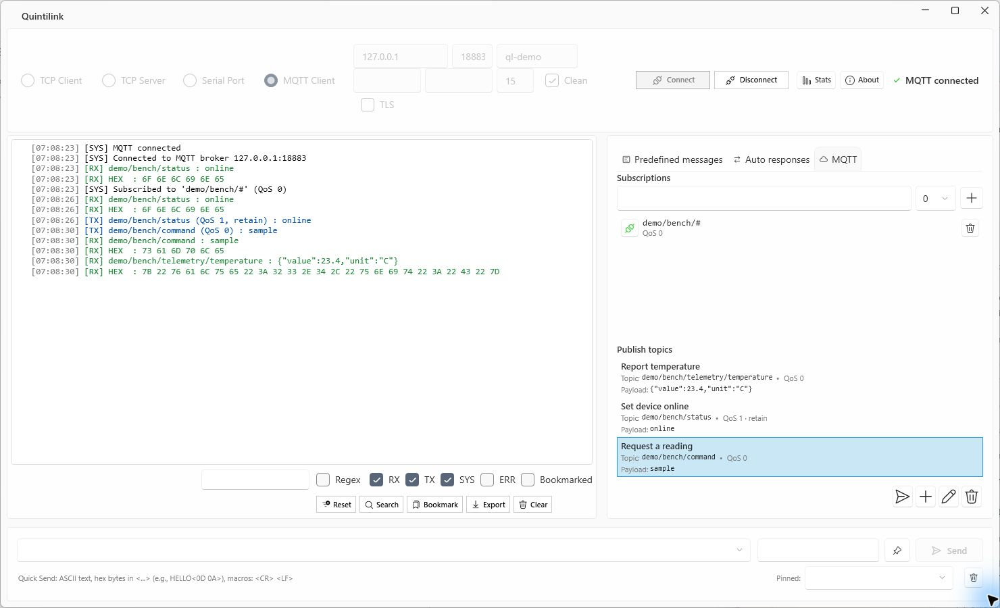
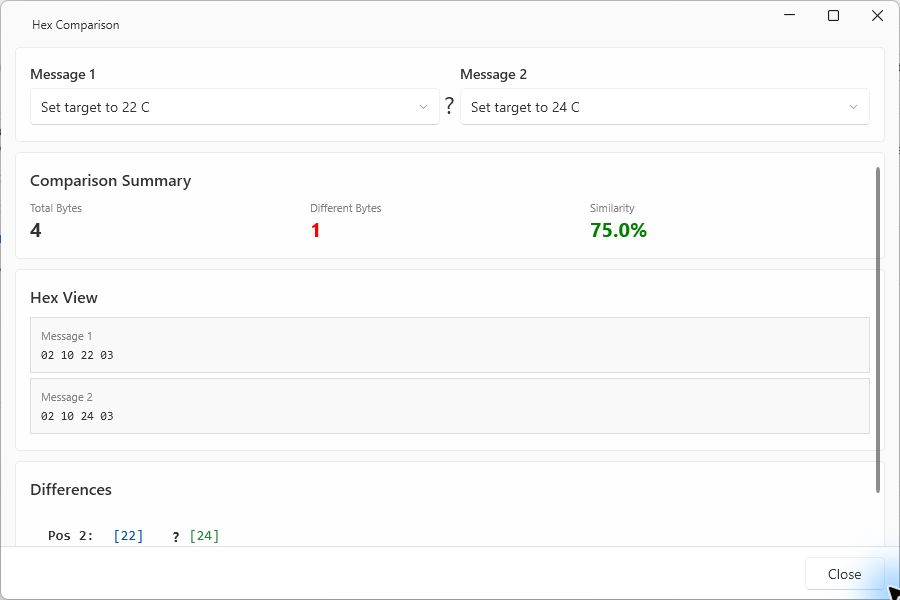

# Quintilink

**Test TCP, serial and MQTT communication from one Windows app.**

Send a command, see the bytes that came back, and keep the messages you want to try again. Quintilink lets you check a device's line endings, simulate a reply, or watch an MQTT topic without writing a test client.

[Download for Windows](https://github.com/pekur/Quintilink/releases/latest) · [Try it locally](#try-it-locally) · [MQTT setup](#mqtt-client)



*A simulated temperature controller replies to two saved commands. The log shows the ASCII and hex for each exchange.*

## Download and run

Download the Windows x64 ZIP from [GitHub Releases](https://github.com/pekur/Quintilink/releases/latest), extract it to a writable folder and open `Quintilink.exe`. The release is self-contained and includes the .NET runtime.

The [1.3.0 release](https://github.com/pekur/Quintilink/releases/tag/Release_1.3.0) predates MQTT support. To try MQTT or follow the screenshots in this README, [build from source](#build-from-source).

## Try it locally

Use **TCP Client** mode with a small echo peer on the same machine. You only need Quintilink and PowerShell.

1. Paste this into PowerShell and leave the window open. If port `19090` is in use, pick another port and use it in both places.

   ```powershell
   $listener = [Net.Sockets.TcpListener]::new([Net.IPAddress]::Loopback, 19090)
   $listener.Start()
   try {
       Write-Host 'Echo peer ready on 127.0.0.1:19090'
       $client = $listener.AcceptTcpClient()
       try {
           $stream = $client.GetStream()
           $buffer = [byte[]]::new(4096)
           while (($count = $stream.Read($buffer, 0, $buffer.Length)) -gt 0) {
               $stream.Write($buffer, 0, $count)
           }
       }
       finally { $client.Dispose() }
   }
   finally { $listener.Stop() }
   ```

2. In Quintilink, select **TCP Client**, enter host `127.0.0.1` and port `19090`, then click **Connect**.
3. Type `PING<CR><LF>` into **Quick Send** and press **Enter**. Look for both **TX** and **RX** in the log. The echo sends back the same six bytes, `50 49 4E 47 0D 0A`.
4. Click the gutter beside a line to bookmark it, then turn on **Bookmarked** to focus on that entry. Click **Disconnect** to finish. Run the PowerShell block again for another session.

## Connection modes

| Mode | What you can do |
| --- | --- |
| **TCP Client** | Connect to a host and port. If connecting takes a while, the Connect button becomes **Cancel**. |
| **TCP Server** | Listen on a port, see how many clients are connected, and broadcast outgoing messages to all of them. Hover over the status to see their endpoints. |
| **Serial Port** | Select a COM port and set baud rate, parity, data bits and stop bits. Refresh the port list after plugging in an adapter. |
| **MQTT Client** | Connect to a broker, subscribe to topic filters and publish either saved or ad hoc payloads. |

### MQTT client

1. Select **MQTT Client** and enter your broker's host and port. Set the optional client ID, credentials, keep-alive and clean-session options as needed. Enable **TLS** if the broker requires it.
2. In the **MQTT** tab, add a filter such as `demo/bench/#` and choose QoS 0, 1 or 2. Saved filters are applied on connect. You can subscribe or unsubscribe from each filter while connected, or remove it from the list.
3. Under **Publish topics**, save a message with a topic such as `demo/bench/telemetry/temperature`, a UTF-8 payload such as `{"value":23.4,"unit":"C"}`, a QoS level and an optional retain flag. Double-click the saved item to publish. With a matching subscription and broker permission, you can see your publication come back in the log.
4. For a one-off publish, enter a topic next to **Quick Send** and send your payload. Quick Send supports mixed ASCII and hex and publishes at QoS 0 with retain off.



## Reuse messages and simulate replies

- **Quick Send** keeps a history of successful sends. Use the pin button to keep a snippet handy across sessions.
- **Predefined messages** lets you name, edit and reuse byte sequences. The editor synchronizes ASCII and hex and shows the byte count. Double-click a saved message to send it.
- **Auto responses** lets you simulate a TCP or serial device. Add a trigger and a reply in ASCII or hex, set a delay in milliseconds, and pause or resume each rule independently.

For a simulated ping reply, enter `PING<CR><LF>` in **Trigger (ASCII)** and `PONG<CR><LF>` in **Response (ASCII)**. With Quintilink in **TCP Server** mode, send the trigger from a second TCP client. Exact matches take precedence over prefix matches. Within the matching group, active rules run in descending priority until a rule with **Stop processing other matches** sends its reply. Rules check one receive operation at a time. A trigger split across two TCP reads can be missed.

### Mix text and bytes in Quick Send

| Input | Bytes sent |
| --- | --- |
| `PING` | `50 49 4E 47` |
| `PING<0D 0A>` or `PING<CR><LF>` | `50 49 4E 47 0D 0A` |
| `<02>DATA<03>` | `02 44 41 54 41 03` |
| `<06 00>` | `06 00` |

Quick Send recognizes `<CR>`, `<LF>` and `<NULL>`. For a tab, use `<09>`. The message and response editors offer additional shortcuts through their macro helper.

## Inspect traffic

- **Log** shows timestamped traffic. TCP and serial payloads appear as ASCII and hex. Filter by text or regex and toggle RX, TX, system, error or bookmarked entries.
- **Search** scans the log for a text or hex pattern and opens a separate results window. Choose a direction, case sensitivity and regex matching as needed. Enter spaced bytes such as `0D 0A` to find line endings.
- **Export** saves the full captured log, including entries hidden by the current filter, as CSV, JSON or plain text.
- **Compare** opens a byte-by-byte comparison of two predefined messages. See both hex sequences, the position and value of each difference, and a similarity score.
- **Stats** shows connection duration, errors, message and byte counts, average message size and RX/TX throughput. Capture a session snapshot to keep a point-in-time reading, or reset the counters for another run.



## Settings and saved messages

Quintilink writes two files next to the executable. Copy them to another extraction folder to bring your setup with you.

| File | Contents |
| --- | --- |
| `store.json` | Predefined messages, auto-response rules, MQTT publish presets and subscription filters |
| `settings.json` | Connection settings, Quick Send history and pins, and window placement |

`settings.json` can contain MQTT credentials in plain text. Use `store.json` when sharing only saved messages and rules.

## Build from source

On Windows with the .NET 10 SDK installed, run:

```powershell
git clone https://github.com/pekur/Quintilink.git
cd Quintilink
dotnet run --project Quintilink/Quintilink.csproj
```

To create a self-contained Windows x64 build:

```powershell
dotnet publish Quintilink/Quintilink.csproj -c Release -r win-x64 --self-contained true
```

## Contributing and license

Pull requests are welcome. For bug reports and feature requests, use [GitHub Issues](https://github.com/pekur/Quintilink/issues).

Quintilink is available for personal, educational, research and evaluation use under the [Non-Commercial License](LICENSE). Commercial use requires a separate commercial license. See [third-party notices](THIRD-PARTY-NOTICES.md) for dependency licenses.

Built with [WPF UI](https://github.com/lepoco/wpfui), [CommunityToolkit.Mvvm](https://github.com/CommunityToolkit/dotnet) and [MQTTnet](https://github.com/dotnet/MQTTnet).
